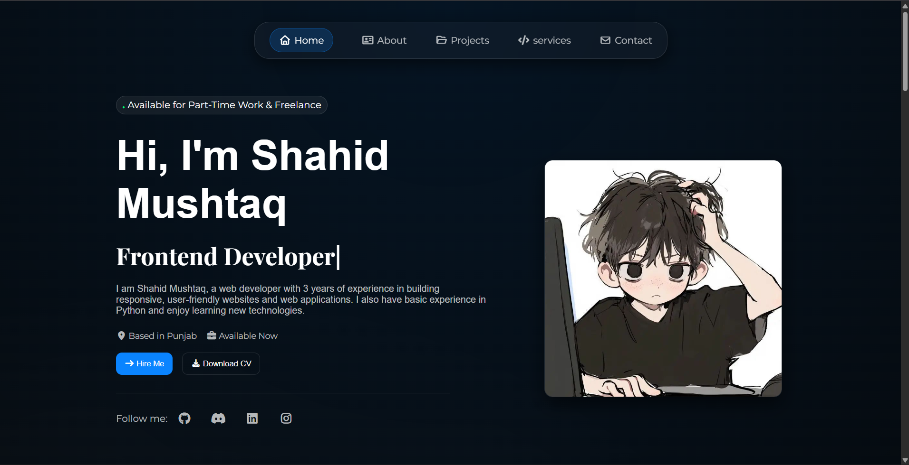

<h1 align="center">Shahid Mushtaq — Portfolio</h1>

<p align="center">
  A personal portfolio showcasing my web development work, skills, services, and projects.
</p>

<p align="center">
  <a href="https://shahidmushtaq.in"><strong>🌐 Visit Live Website</strong></a>
  &nbsp;•&nbsp;
  <a href="https://github.com/shahid-2153">GitHub</a>
  &nbsp;•&nbsp;
  <a href="https://www.linkedin.com/in/shahid2153/">LinkedIn</a>
</p>

<p align="center">
  
  
  
  
</p>

---

## About

This is my personal portfolio website, built to introduce me as a developer and provide a central place to explore my work. It uses a dark visual theme, responsive layouts, and lightweight JavaScript interactions.

**Live website:** [https://shahidmushtaq.in](https://shahidmushtaq.in)

## What You'll Find

- **Home** — Introduction, rotating role text, and links to my profiles and CV.
- **About** — A short overview of my background, interests, and technical skills.
- **Projects** — Selected projects with source-code links and live demos where available.
- **Services** — Website design, landing pages, UI improvements, and basic website fixes.
- **Contact** — Contact form and ways to connect with me.

## Features

- Responsive layout for desktop, tablet, and mobile screens.
- Dark interface with blue accent styling.
- Network-aware introductory loading screen, with a fallback for browsers that do not expose connection details.
- Typewriter effect cycling through **Frontend Developer**, **UI/UX Designer**, and **Web Enthusiast**.
- Smooth in-page navigation and scroll-based section reveals.
- Reduced-motion preference support.
- Contact form powered by EmailJS.
- Project cards linking to GitHub repositories and deployed demos.

## Featured Projects

| Project | Description | Links |
|---|---|---|
| **CYBRO — E-commerce Website** | Responsive storefront interface with product browsing and cart interactions. | [Source](https://github.com/shahid-2153/CYBRO-E-commerce) · [Live Demo](https://shahid-2153.github.io/CYBRO-E-commerce/) |
| **MiniFlix** | Movie-streaming website interface with dynamic content and a custom player experience. | [Source](https://github.com/shahid-2153/MiniFlix) · [Live Demo](https://miniflix-4zd.pages.dev/) |
| **Readers Library** | Library management application for student profiles, seats, fee payments, receipts, and attendance. | [Source](https://github.com/shahid-2153/Readers-Library) · [Live Demo](https://readers-library.pages.dev/) |
| **Tic Tac Toe** | Browser game with turn tracking and winner detection. | [Source](https://github.com/shahid-2153/Tic-Tac-Toe-Game) · [Live Demo](https://tic-tac-toe-game-4tt.pages.dev/) |
| **Rock Paper Scissors** | Browser game with computer-generated moves and score tracking. | [Source](https://github.com/shahid-2153/Rock-Paper-Scissors-Game) · [Live Demo](https://rock-paper-scissors-game-46z.pages.dev/) |
| **Business Card Template** | Browser-based business card creator with template selection and live previews. | [Source](https://github.com/shahid-2153/Business-Card-Tampelate) · [Live Demo](https://shahid-2153.github.io/Business-Card-Tampelate/) |
| **AI Voice Assistant** | Python desktop assistant with speech recognition, text-to-speech, and task automation. | [Source](https://github.com/shahid-2153/AI-Assistant) |

Some projects are separate applications and are maintained in their own repositories. Projects without a browser-hosted deployment are linked to their source code only.

## Built With

- **HTML5** for page structure and semantic markup.
- **CSS3** for styling, responsive layouts, and animations.
- **Vanilla JavaScript** for navigation, interactions, typewriter text, loading behavior, and form handling.
- **EmailJS** for contact-form delivery.
- **Font Awesome** for interface icons.
- **Google Fonts** for typography.
- **Cloudflare Pages** for hosting.

## Run Locally

This is a static website. No build step is required.

1. Clone the repository:
   ```bash
   git clone https://github.com/shahid-2153/Portfolio.git
   ```
2. Open the project folder.
3. Open `Portofolio/index.html` in your browser, or serve the `Portofolio` directory with a local development server.

The contact form uses the EmailJS configuration in the project JavaScript. To use your own EmailJS account, configure your own service and template identifiers rather than reusing someone else's credentials.

## Connect With Me

- **Portfolio:** [shahidmushtaq.in](https://shahidmushtaq.in)
- **GitHub:** [@shahid-2153](https://github.com/shahid-2153)
- **LinkedIn:** [shahid2153](https://www.linkedin.com/in/shahid2153/)
- **Email:** [shahidmushtaq2155@gmail.com](mailto:shahidmushtaq2155@gmail.com)
- **Instagram:** [@__shahid01](https://www.instagram.com/__shahid01/)

---

<p align="center">
  Designed and developed by <strong>Shahid Mushtaq</strong>
</p>
